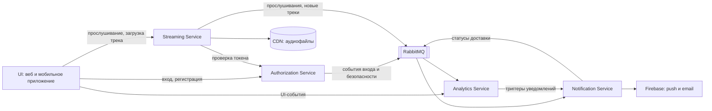
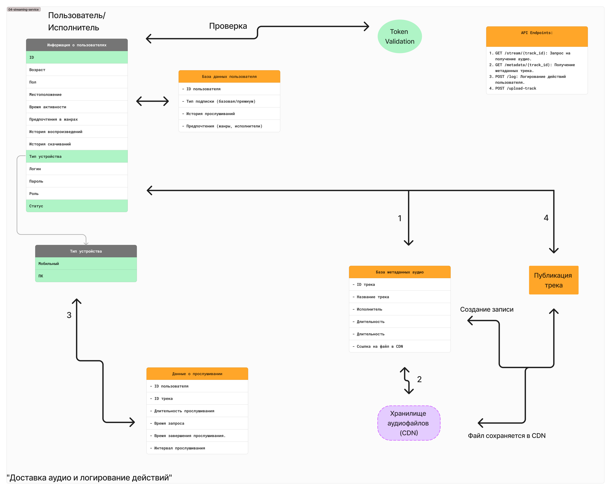
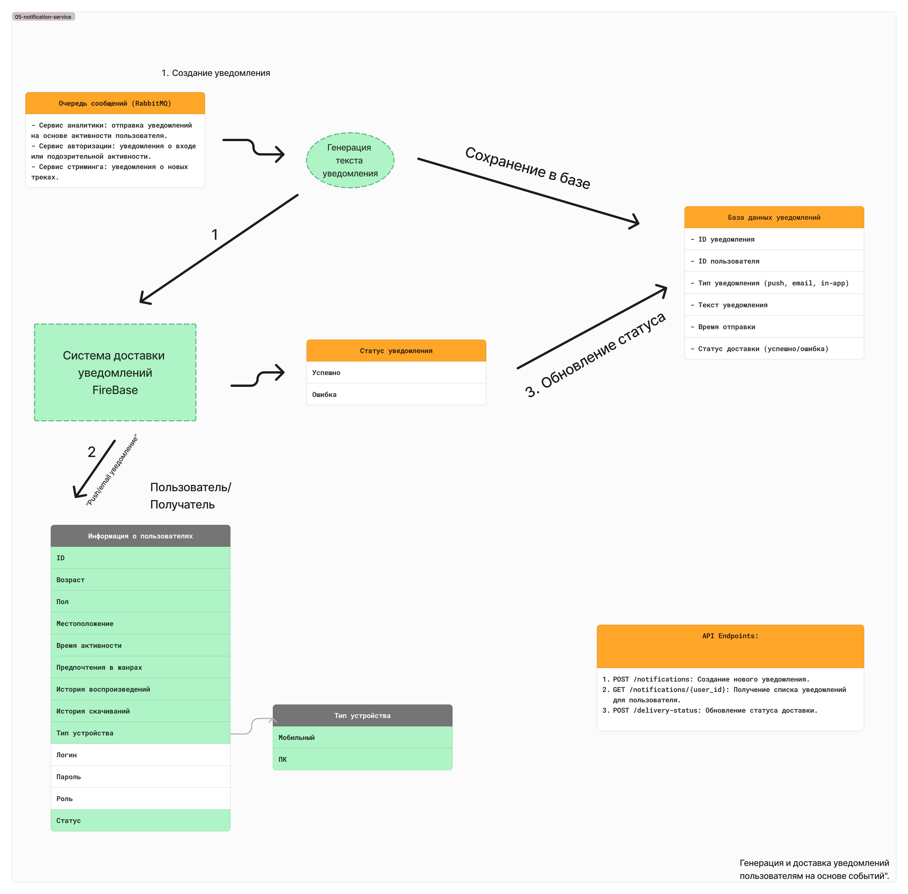
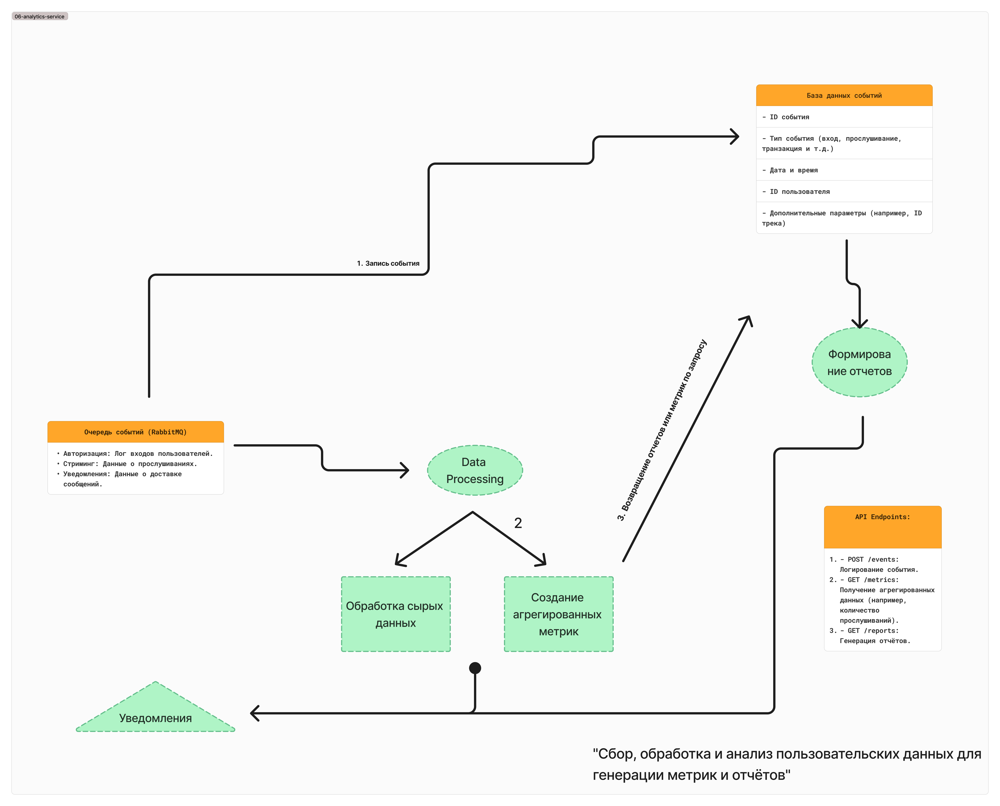
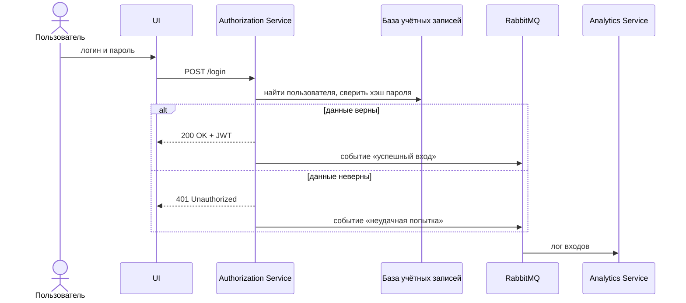
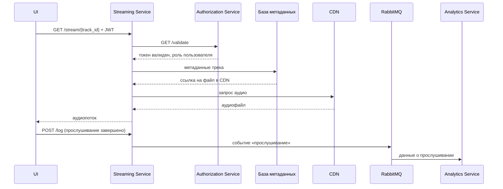
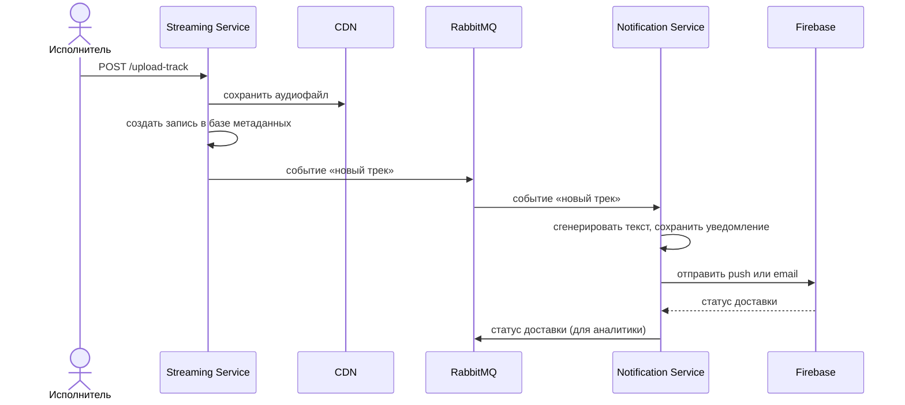

# SoundCloud Service Prototype — системный дизайн стримингового сервиса

> Учебный проект, 2024 год · РГУ им. А.Н. Косыгина. Это моя модель сервиса по образу SoundCloud, а не реальная архитектура компании.

**Доска FigJam со всеми схемами в полном размере:** [открыть в Figma](https://www.figma.com/board/zAyQlTBkJC4BdXSo8YNMy4/SoundCloud-Service-Prototype)


## Задача

Спроектировать стриминговый сервис по типу SoundCloud на двух уровнях:

1. **Система:** разбить продукт на микросервисы, определить зону ответственности каждого, его данные, API и способ обмена событиями.
2. **Бизнес-контекст:** описать оргструктуру компании и какими данными владеют её подразделения.

## Что сделано

- Декомпозиция на 4 сервиса + клиентское приложение: **Authorization**, **Streaming**, **Notification**, **Analytics**.
- Для каждого сервиса: назначение, модель данных (сущности и поля), REST-эндпоинты.
- Асинхронное взаимодействие через брокер сообщений **RabbitMQ**: сервисы публикуют события, аналитика и уведомления их потребляют.
- Проверка прав доступа через **JWT**: Auth выдаёт токен, Streaming проверяет его перед отдачей аудио.
- Сбор **UI-событий** для продуктовых метрик (нажатия Play, заполнение формы загрузки трека, время до первого взаимодействия с плеером).
- Оргструктура: руководство (CEO, COO, CFO, CTO, CPO) и 9 отделов с подразделениями.
- Карта данных подразделений: какие данные ведёт каждый отдел и как они связаны через общую шину данных.

## Общая схема взаимодействия



## Сервисы

| Сервис | За что отвечает | Данные | API |
|---|---|---|---|
| **Authorization** | Вход, регистрация, выдача и проверка JWT, события безопасности | Учётные записи (ID, логин, хэш пароля, роль, статус); события входа (успешный, неудачный, дата последнего входа); события безопасности (подозрительные попытки, блокировка) | `POST /login`<br>`POST /register`<br>`GET /validate` |
| **Streaming** | Доставка аудио, загрузка и публикация треков, логирование прослушиваний | Метаданные аудио (ID, название, исполнитель, длительность, ссылка на файл в CDN); данные о прослушивании (пользователь, трек, длительность, время начала и окончания); профиль слушателя (тип подписки, история, предпочтения) | `GET /stream/{track_id}`<br>`GET /metadata/{track_id}`<br>`POST /log`<br>`POST /upload-track` |
| **Notification** | Генерация и доставка уведомлений (push, email, in-app) по событиям других сервисов | Уведомления (ID, пользователь, тип, текст, время отправки, статус доставки) | `POST /notifications`<br>`GET /notifications/{user_id}`<br>`POST /delivery-status` |
| **Analytics** | Сбор событий, обработка сырых данных, агрегированные метрики и отчёты | События (ID, тип, дата и время, пользователь, доп. параметры — например, ID трека); UI-события | `POST /events`<br>`GET /metrics`<br>`GET /reports` |

<details>
<summary>Схемы сервисов</summary>

**Authorization Service** — управление входом и проверкой прав доступа


**Streaming Service** — доставка аудио и логирование действий


**Notification Service** — генерация и доставка уведомлений на основе событий


**Analytics Service** — сбор и анализ пользовательских данных для метрик и отчётов


</details>

## Ключевые сценарии

### 1. Вход пользователя



### 2. Прослушивание трека



### 3. Публикация трека и уведомление слушателей



## Бизнес-контекст

### Оргструктура компании

Руководство (CEO, COO, CFO, CTO, CPO) и 9 отделов: по работе с кадрами, маркетинга и коммуникаций, юридический, данных и аналитики, по работе с контентом, инженерно-технический, финансово-стратегический, бухгалтерии, документооборота.


### Данные подразделений и интеграционная шина

Какие данные ведут подразделения: персональные и профессиональные данные сотрудников, данные пользователей и история входов, системные логи и нагрузка на инфраструктуру, контент и метаданные треков, платежи, подписки и отчёты о прибыли, лицензии и права на контент, рекламные кампании и соцсети, документооборот. Шина данных на этом уровне показана концептуально — как общий канал обмена данными между подразделениями.


## Что бы улучшил

1. **Единый профиль пользователя.** Таблица «Информация о пользователях» повторяется в трёх сервисах, и в ней вместе лежат профиль (возраст, жанры, история) и учётные данные (логин, пароль). В микросервисной архитектуре у каждого сервиса свои данные: учётную запись оставил бы в Auth (как в таблице users с хэшем пароля), а профиль и предпочтения вынес бы в отдельный User Profile Service.
2. **API Gateway.** Сейчас UI обращается к сервисам напрямую. Шлюз взял бы на себя маршрутизацию и проверку JWT, и сервисам не пришлось бы вызывать `/validate` на каждый запрос.
3. **Именование REST-ресурсов.** Заменил бы глаголы в путях на ресурсы: `POST /upload-track` → `POST /tracks`, `POST /delivery-status` → `PATCH /notifications/{id}/status`, `POST /log` → `POST /listening-events`. API описал бы в OpenAPI.
4. **Контракты событий.** Для RabbitMQ сейчас указано только, *что* передаётся. Описал бы формат сообщений: очередь или exchange, routing key, JSON-схему события.
5. **Связь уровней.** Шина данных на бизнес-уровне и RabbitMQ на системном уровне нарисованы независимо — явно показал бы, что брокер реализует эту шину.
6. **Персональные данные.** В карте данных есть паспортные данные и сведения о страховании сотрудников — добавил бы, кто имеет к ним доступ, и требования 152-ФЗ.
7. **Матрица «подразделение × данные».** Привязка блоков данных к отделам на схеме местами неочевидна; таблица «владелец / потребитель» для каждого набора данных читалась бы лучше.

## Инструменты

FigJam — все схемы. Нотация свободная (блоки, таблицы сущностей, стрелки потоков); в следующих проектах использую BPMN 2.0 и UML. Диаграммы сценариев в этом README — Mermaid.

## Структура репозитория

```
soundcloud-system-design/
├── README.md
└── images/
    ├── 01-overview.png
    ├── 02-microservices.png
    ├── 03-auth-service.png
    ├── 04-streaming-service.png
    ├── 05-notification-service.png
    ├── 06-analytics-service.png
    ├── 07-org-structure.png
    └── 08-data-domains.png
```

## Планы

- [ ] Спецификация API в OpenAPI (`api/openapi.yaml`)
- [ ] Коллекция запросов Postman
